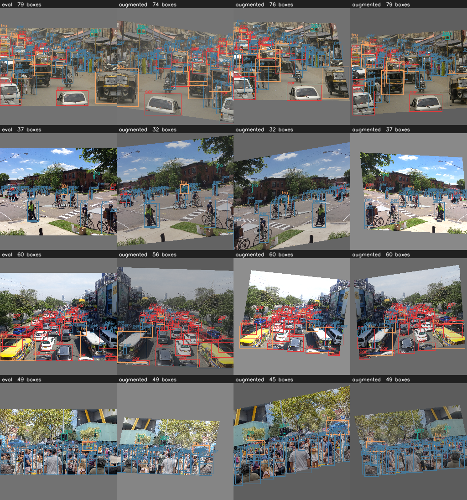
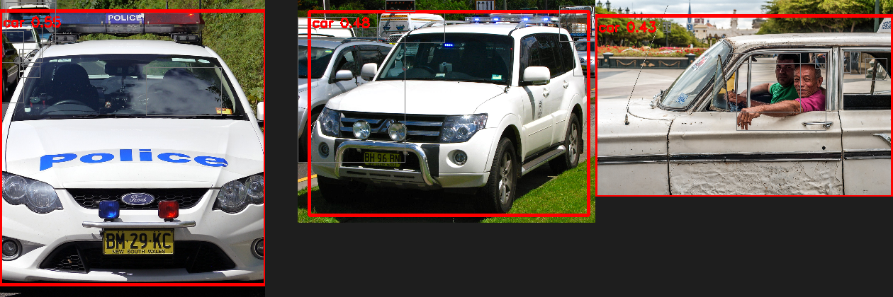

# Street-Scene Detection: Collection, Training and Audit

An end-to-end object detection pipeline built from scratch: a scraped and
automatically labelled dataset, a custom CNN detector with no pretrained
backbone, and an agentic RAG system that audits both.

| Phase | Deliverable | What it does |
| --- | --- | --- |
| 1 | [`collect_and_annotate.py`](collect_and_annotate.py) | Scrapes Wikimedia Commons with Playwright, screens every image with a vision model, labels with Grounding DINO, writes validated COCO |
| 2 | [`dataset.py`](dataset.py) | COCO parser and OpenCV geometry pipeline where boxes follow pixels under every transform |
| 2 | [`train.py`](train.py) | Custom anchor-free detector, manual training loop, custom loss, scheduler, early stopping, TensorBoard |
| 3 | [`llm_auditor.py`](llm_auditor.py) | Vector store over annotations and metrics, four Python tools, Gemini tool-calling agent |
| — | [`requirements.txt`](requirements.txt) | Exact pinned versions, generated from the installed environment |
| — | [`tests/`](tests) | 48 tests, the important ones verifying geometry against real pixels |

---

## Quick start

```bash
python -m venv .venv && .venv\Scripts\activate
pip install -r requirements.txt
playwright install chromium
copy .env.example .env          # then add your GEMINI_API_KEY

python collect_and_annotate.py scrape --target 250
python collect_and_annotate.py annotate
python -m pytest tests/ -q
python train.py --epochs 60 --batch-size 8
python llm_auditor.py build
python llm_auditor.py demo
```

---

## Phase 1 — Data collection and annotation

### Choosing the category

The category had to satisfy two conflicting requirements: enough visual
complexity to be a real detection problem, and labels a human can verify by
eye. Street scenes were chosen over alternatives like circuit boards or
medical imagery precisely because **anyone can check whether a box is around
a car**. An automatic labelling pipeline whose output nobody can audit is not
a dataset, it is a guess.

Street scenes also give, for free, the properties that make detection hard:
many objects per image, heavy scale variation, occlusion, and a natural class
imbalance nobody had to manufacture.

### Source

Wikimedia Commons, not Openverse. The first attempt used Openverse and its
"originals" turned out to be about 500px on the long edge, which fails the
high-resolution requirement outright. Commons serves genuine multi-megapixel
originals.

Pagination was the second surprise. The "Load more" control is not an append
button — it navigates to `&continue=N` and *replaces* the grid — so the
original click loop silently re-read the same first page and capped every
search term at about 40 results. Rewriting it as explicit offset pagination
took candidates per term from 52 to 160.

A further 7x speedup came from extracting the whole result grid in a single
`page.evaluate()` rather than per-element Playwright locators, which block on
lazily-loaded images and go stale when the grid re-renders.

### Quality screening

Every downloaded image is screened by **Gemini 3.1 Flash Lite** before it is
kept. This is a *gate*, not a labeller — it answers "is this a real
photograph of a street scene with at least two target objects, and is it
sharp", and the actual boxes come from Grounding DINO.

Images are downscaled to 1024px before being sent for screening. Sending
originals meant a 16.3MB base64 payload against a 20MB inline limit; the
downscale brings it to 0.11MB, **150x smaller**, with no effect on the
judgement being made.

### The collection funnel

| Stage | Count |
| --- | --- |
| Candidates found across 25 search terms | 974 |
| Downloaded | 622 |
| Decoded and hashed | 443 |
| **Accepted** | **250** |
| Rejected | 193 |

Rejections, which are the interesting part:

| Reason | Count |
| --- | --- |
| Too few target objects | 89 |
| Not a street scene | 41 |
| Not a photograph (illustration, map, diagram) | 33 |
| Blurred | 24 |
| Night-time | 2 |
| Watermarked | 1 |
| Verification error | 3 |

Only 3 verification errors in 443 calls, so no retry logic was needed.

**Search terms were ordered by measured yield, not intuition.** Computing
per-term acceptance rates from the manifest showed the most *specific* term,
`street traffic cars`, was the worst at 31%, while the most *generic*,
`traffic`, was the best at 86%. Three low-yield terms were dropped.

A related measurement prevented a wasted optimisation: replaying the cached
verdicts showed that relaxing `MIN_INSTANCES` from 2 to 1 would have gained
only 3 images, because **65 of 180 rejected images contained zero target
objects**. The bottleneck was candidate quality, not filter strictness.

### Resulting dataset

- **250 images**, 0.97 GB, all JPEG
- Minimum short edge **809px**, median **2448px**, median **9.6 megapixels**
- **4,857 annotations**, mean 19.4 per image, median 12, maximum 114
- Box area from 58 px² to 11.2M px²; median box is **0.205% of its image**

| Class | Instances | Share | Images containing |
| --- | --- | --- | --- |
| car | 2,127 | 43.8% | 216 |
| person | 1,819 | 37.5% | 213 |
| traffic light | 530 | 10.9% | 181 |
| truck | 381 | 7.8% | 168 |

A **5.58:1** imbalance that occurred naturally, which Phase 3 is expected to
find.

### Reproducibility

`data/manifest.json` records every image's source URL, SHA-256, dimensions,
licence, originating search term and the full verifier verdict. The dataset
is therefore rebuildable from two small files rather than a 1 GB upload — and
[`notebooks/kaggle_annotate.ipynb`](notebooks/kaggle_annotate.ipynb) proves it
by re-downloading from the manifest and verifying each hash before use.

Annotation is resumable: interrupting and restarting repeats no downloads and
consumes no additional API quota.

### Deliberately *not* cleaned

201 boxes under 32x32px, 57 near-duplicate pairs and 12 oversized boxes were
left in. Filtering them here would have hidden exactly the problems the Phase
3 auditor exists to find.

---

## Phase 2 — Dataset, geometry and the detector

### One matrix, one warp

Every geometric augmentation is a 3x3 affine matrix. They are **composed
first** and applied to the pixels exactly once with a single `cv2.warpAffine`,
and the *same* composed matrix maps the boxes.

```
resize -> centre -> flip -> scale -> rotate -> shear -> translate
```

Chaining separate transforms would resample the image repeatedly, blurring it
and accumulating rounding error, and would give the boxes several independent
chances to drift out of sync with the pixels. One matrix means one thing to
get wrong.

Boxes are mapped by warping **all four corners** and taking the axis-aligned
bounds. Warping only the top-left and bottom-right corners is the classic
bug: correct for scale and translation, silently wrong under rotation or
shear. `test_two_corner_shortcut_is_wrong_under_rotation` fails if anyone
"simplifies" it back.

A box pushed mostly off-canvas is worse than no box — it teaches the model
that a sliver of a car is a whole car — so boxes retaining under 30% of their
original area are dropped, with the reference area scaled by the matrix
determinant so a zoom is compared like with like.

### Proving it rather than asserting it



Each row is one image: the evaluation transform first, then random training
augmentations. Box counts fall as objects genuinely leave the frame
(79→74, 37→32).

The decisive test is `test_boxes_agree_with_warped_pixels`: for each of nine
matrices, every box is rendered as a mask, the mask is warped with the *same*
matrix, and the warped mask's bounds are compared against the predicted box.
Checking transformed boxes against hand-computed numbers only proves the
arithmetic agrees with itself; this tests the property training actually
depends on.

### Architecture

A single-shot, anchor-free detector in the CenterNet family, **written from
scratch — no ResNet, no torchvision backbone, no pretrained weights**.
2.58M parameters.

```
input 384x384
  stem    /2   conv x2            32ch
  stage2  /4   conv x2            64ch
  stage3  /8   conv + residual   128ch
  stage4  /16  conv + residual   256ch
  decoder /16 -> /8 -> /4, fusing the matching encoder stage
  heads   at /4 (96x96): heatmap[4], size[2], offset[2]
```

Each choice follows from a measured property of this dataset:

- **Anchor-free** because the images are crowded (mean 19 boxes, max 114).
  Anchor matching and NMS tuning would both be prerequisites to getting
  anything working; a heatmap peak per object avoids both, and a 3x3 max-pool
  peak test replaces NMS entirely.
- **Decoder fusing back to stride 4** because the objects are small: the
  median box is 0.205% of its image, roughly 17px at 384 input. At stride 4
  that is still four cells. This is also why input is **384, not 256** — at
  256 the median object would span under three cells and the 201 sub-32px
  boxes would vanish.
- **GroupNorm throughout** because batch size is 8–16, where BatchNorm's
  running statistics are noisy and create a train/eval gap easily mistaken
  for overfitting.
- **Bilinear upsample + conv**, not `ConvTranspose2d`, whose checkerboard
  artefacts show up on a heatmap as spurious peaks.
- **Two residual blocks**, at the deepest stages only, where the gradient
  path is longest.

### Loss

Penalty-reduced focal loss on the heatmap plus masked L1 on size and offset.

Plain BCE fails here: the target is about 0.1% positive, so predicting zero
everywhere already scores nearly perfectly. The `alpha` term down-weights
already-correct examples, and `beta` softens the penalty on negatives *near*
a centre using the Gaussian value itself — a pixel one cell from a car's
centre is not really a negative.

Size is weighted 0.1 because it is measured in grid cells and can reach ~96,
which would otherwise swamp the heatmap gradient.

### Training loop

Written out explicitly — no Trainer, no Lightning:

- **AdamW**, lr 2.5e-4, weight decay 1e-4
- **Linear warmup then cosine decay**, stepped per update. Warmup matters
  because the heatmap head starts at a deliberately biased initialisation;
  full learning rate on step one undoes that bias before the backbone has
  learned anything.
- **Early stopping on validation mAP@0.5, with a validation-loss fallback.**
  Detection loss is dominated by the heatmap term and can improve while the
  boxes get worse, so mAP is the real criterion. But while mAP is still below
  a meaningfulness floor (0.02) it is mostly noise, so a falling validation
  loss counts as progress until mAP clears that floor. A first version
  monitored mAP alone and killed a healthy run at epoch 13 (see the
  post-mortem below).
- **Gradient clipping** at norm 5, so one batch containing a 114-box crowd
  image cannot undo an epoch.
- **TensorBoard** logging per-batch loss/lr/grad-norm, per-epoch train and
  validation metrics, per-class AP, and augmented sample images each epoch
  with ground truth in green and predictions in red — so the panel answers
  "is it learning?", not merely "did augmentation run?".
- Split 70/15/15 by image id, deterministic from a seed.

### The full training run

`python train.py --epochs 60 --batch-size 8 --workers 2 --patience 12 --run-name full-384`

175 training images, 21 batches per epoch, 2,576,488 parameters, CPU, ~166s
per epoch. Early stopping ended it at epoch 52; the best validation mAP@0.5
was **0.0244 at epoch 40**. `runs/full-384/config.json` records the exact
configuration and `is_smoke_test: false`, so the numbers below cannot be
mistaken for a truncated run.

| epoch | train loss | heatmap | size | offset | val loss | val mAP@0.5 |
|------:|-----------:|--------:|-----:|-------:|---------:|------------:|
| 0  | 8.441 | 4.494 | 3.006 | 0.942 | 8.016 | 0.0000 |
| 5  | 4.480 | 2.572 | 1.401 | 0.507 | 4.353 | 0.0007 |
| 10 | 3.952 | 2.299 | 1.154 | 0.499 | 4.026 | 0.0048 |
| 20 | 3.580 | 2.104 | 0.984 | 0.492 | 3.900 | 0.0112 |
| 30 | 3.357 | 1.972 | 0.902 | 0.483 | 3.730 | 0.0208 |
| 40 | 3.069 | 1.832 | 0.763 | 0.474 | 3.666 | **0.0244** |
| 52 | 2.919 | 1.750 | 0.696 | 0.473 | 3.668 | 0.0167 |

Per-class AP@0.5 at the best epoch: car 0.038, truck 0.000, traffic light
0.058, person 0.002.

Reading this honestly:

- **It learns.** mAP rises monotonically in trend from 0 to 0.024 and the
  size term falls 3.006 → 0.696. The earlier broken run peaked at 0.005, so
  the two fixes bought roughly a 5x improvement.
- **It converged rather than being cut off.** Validation loss bottomed at
  3.632 (epoch 47) and sat in a 3.63–3.69 band for the last twelve epochs
  while training loss kept falling — the gap between 2.92 and 3.67 is the
  model starting to memorise 175 images. More epochs would not have helped;
  more images would.
- **0.024 mAP is low, and that is the expected outcome here.** A
  2.6M-parameter detector trained from random initialisation on 175 images
  has no chance against the 100k+ images a published CenterNet result
  assumes. The per-class split shows where the little signal there is lands:
  traffic lights and cars, the two most numerous and most visually
  stereotyped classes. Truck (381 instances) never gets off zero.
- **This is a data-scale result, not a code defect** — which is exactly what
  the overfit check below establishes independently.

### Proving the detector works before blaming the data

`python scripts/overfit_check.py` trains the model repeatedly on **one fixed
batch of four images** and evaluates on those same images. A correct detector
must be able to memorise them; if it cannot, the target encoding, the loss or
the decoder is broken and training on the real split is pointless.

```
step   0  loss 8.4129  hm 4.5125  size 2.9577  off 0.9427
step 100  loss 0.1199  hm 0.0057  size 0.0854  off 0.0289
step 300  loss 0.0530  hm 0.0011  size 0.0317  off 0.0202
  image 0: 81 ground truth, 75 predicted
  image 1: 14 ground truth, 14 predicted
  image 2: 10 ground truth, 10 predicted
  image 3: 22 ground truth, 22 predicted
per-class AP@0.5: {0: 1.0, 1: 1.0, 2: 1.0, 3: 0.935}
mAP@0.5: 0.9839
```

**mAP 0.984, with exact box counts recovered.** This is the evidence that the
pipeline is correct end to end, and that the modest mAP on the real split
reflects having only 175 training images for a from-scratch detector, not a
defect. Without this check there is no way to tell those two causes apart.

### A bug the initialisation test caught

The first smoke test showed an initial loss of **196** where theory predicted
about 4.5. The cause: `kaiming_normal_(mode="fan_out")` was being applied to
*every* convolution including the 1x1 prediction heads, so their weight term
swamped the carefully-set `-log(99)` heatmap bias. The bias was doing nothing.

With near-zero head weights, step 0 now reports `hm 4.5186` against a
predicted 4.52. `test_heatmap_starts_near_one_percent` fails if it regresses.

### Tests

**48 tests, all passing.** Beyond the geometry tests, `test_detection.py`
round-trips boxes through target encoding and back out through the decoder,
requiring IoU > 0.98. Without it, an encoder/decoder disagreement would let
the loss fall to zero while the detector emitted nonsense.

One test documents a *limitation* rather than hiding it: max-pool NMS keeps
cells that **equal** their 3x3 maximum, so a perfectly flat plateau survives
intact. This is inherited from standard CenterNet and harmless with real
float outputs, but the test will warn if the heatmap ever becomes quantised.

---

## Phase 3 — The agentic RAG auditor

### Retrieval supplies descriptions; tools supply numbers

A vector store is good at finding the right passage and useless at counting.
Asked "how many boxes are under 1000 square pixels", a retrieval-only system
hands the model a few prose chunks and the model invents a plausible figure.

So the corpus carries the qualitative material — what the dataset is, what
each class looks like, what is already known to be wrong — while **every
exact quantity is computed by a Python tool reading `annotations.json`
directly**. The model chooses the tools; it never does the arithmetic.

### Corpus

259 chunks, embedded with `all-MiniLM-L6-v2` into a persistent Chroma
collection using cosine distance. Chunking is **semantic, not fixed-width**:
a sliding window over pretty-printed JSON would split a box away from its
image and retrieve fragments that mean nothing.

| Source | Chunks |
| --- | --- |
| Per-image summaries | 250 |
| Per-class summaries | 4 |
| Dataset overview | 1 |
| Known quality concerns | 1 |
| Training epochs + run configuration | 3+ |

Embeddings are computed locally: the corpus is rebuilt whenever the
annotations change, and paying per rebuild for a few hundred short passages
would be pointless.

### Tools

| Tool | Purpose |
| --- | --- |
| `compute_box_statistics` | Area percentiles, filtered by class and/or area range |
| `check_class_balance` | Counts, shares, image coverage, imbalance ratio |
| `find_suspicious_annotations` | Tiny boxes, near-duplicates, out-of-bounds, oversized, low confidence |
| `summarise_training` | Best epoch, generalisation gap, run validity |

The SDK's automatic function calling is **disabled deliberately** so the loop
runs explicitly and every call, argument and result can be logged.

---

## End-to-end demo run

Full transcript: [`data/audit_logs/demo_transcript.json`](data/audit_logs/demo_transcript.json)

**4 scenarios, 6 tool calls, all 4 distinct tools used.** Run against the
real `full-384` training log, not a smoke test.

### Scenario 1 — "Are there suspiciously small bounding boxes?"

Tool called: `find_suspicious_annotations({"max_area": 1024})`.

> There are 201 boxes with an area smaller than 1024 square pixels,
> representing 4.14% of the dataset. The smallest box found has an area of
> 58.1 square pixels [...] These annotations are worth a human looking at.

Note that the agent chose the area threshold itself from the wording
"suspiciously small" — the question never gave it a number.

### Scenario 2 — "Is this dataset class balanced?"

Tool called: `check_class_balance`.

> The dataset is not class balanced. The imbalance ratio between the most
> frequent class (**car**, 2,127 instances) and the least frequent class
> (**truck**, 381 instances) is **5.58 to 1**.
>
> [...] The model will likely be biased toward predicting "car" and "person"
> [...] The "truck" and "traffic light" classes are under-represented and may
> suffer from lower recall.

It rendered the full distribution as a table and then listed five expected
training consequences, including label noise and duplicate detections —
numbers it took from the tool, consequences it reasoned about itself.

### Scenario 3 — "Biggest risk to accuracy, and what to fix first?"

Tool called: `summarise_training`, on retrieved chunks that included
`training-diagnostics`.

> The single biggest risk to the model's accuracy is the **extremely small
> dataset scale**. With only 175 training images available for a detector
> trained from random initialization, the model lacks sufficient data to
> generalize, as evidenced by the significant generalization gap (0.7492) and
> the validation mAP@0.5 peaking at only 0.0244.
>
> While the dataset contains label noise [...] the training diagnostics
> confirm that the annotations are "learnable signal" rather than noise.
> Therefore, fixing label quality is a secondary concern.

This is the right answer, and it took two corpus fixes to get there — see
post-mortem items 3 and 6.

### Scenario 4 — "How many car boxes between 2000 and 20000 px², and how does the median compare?"

Tools called: `compute_box_statistics` **three times** —
`{class_name: "car", min_area: 2000, max_area: 20000}`, then
`{class_name: "car"}`, then `{}`.

> There are 950 'car' boxes with an area between 2,000 and 20,000 square
> pixels. The median area for 'car' boxes is 17,347.3 square pixels, while
> the median area across all classes is 17,072.1 [...] slightly larger than
> the overall dataset median.

This scenario exists because it is **unanswerable from retrieval**. No chunk
states a count inside an arbitrary area window, so prose cannot supply it; the
agent had to decompose one question into three computations and compare the
results. Retrieval set up the question, the tool answered it.

---

## Six things that went wrong, and what they changed

The first full training run reached **mAP 0.005** and stopped at epoch 13.
Two independent faults, both found by reading the per-component losses rather
than the total — the total loss fell smoothly throughout and looked healthy.

### 1. The size head could not learn

Its L1 sat at ~9 *grid cells* while the median object is only ~4 cells
across. The predicted boxes were wrong by more than the objects were big, so
nothing could clear IoU 0.5 and mAP was pinned at zero however long it ran.

The cause was regressing raw width and height, whose range here runs from 4
cells to 96. L1 on raw values is dominated by a handful of very large boxes,
leaving the small objects that make up most of this dataset with almost no
gradient. Sizes are now regressed in **log space**, where error is relative:
a 2-cell mistake on a 4-cell object counts as much as a 48-cell mistake on a
96-cell one. Initial size loss fell from 14.0 to 2.97, and the loss weight
went from 0.1 to 1.0 since log-space values are already order-1.

### 2. Early stopping fired on noise, hiding it

It monitored mAP alone. mAP peaked at 0.0051 at epoch 3 purely by chance and
never beat it, so patience ran out at epoch 13 — even though validation loss
had fallen *every single epoch* since. The run was killed while the model was
still plainly learning.

Early stopping now treats a falling validation loss as progress while mAP is
below a meaningfulness floor (0.02), and switches to mAP alone once mAP
clears it, because past that point loss and detection quality can genuinely
diverge. `test_falling_val_loss_counts_as_progress_while_map_is_noise` fails
if that regresses.

### 3. The auditor confidently misdiagnosed the training run

An earlier run of scenario 3 blamed a validation mAP of 0.0 on label quality.
The real cause was that the only available log came from a 3-epoch smoke test
over 6 batches — and **the corpus never said so**.

Grounding does not prevent a wrong conclusion when the evidence is
incomplete. `train.py` now writes `config.json` recording `is_smoke_test`,
batches per epoch and the full argument set, and both the corpus and
`summarise_training` carry an explicit warning. The quoted scenario 3 answer
above is the same question after the fix.

### 4. "Oversized boxes" were not the error I claimed

A check for boxes covering most of their image flagged 12, which looked like
obvious detector failures. **Looking at them showed the labels were correct** —
they are close-up photographs where one vehicle genuinely fills the frame.



The check was kept but its *meaning* corrected: it now reports a dataset
composition signal (an image is an object portrait, not a street scene)
rather than a labelling error. The root cause traces back to relaxing
`REQUIRE_STREET_SCENE` during collection to improve throughput, which is now
recorded in the corpus so the auditor can reason about it. The auditor
independently surfaced this as "domain inconsistency".

### 5. `--force` destroyed two good answers

The first `--force` implementation cleared previous results *before* knowing
the re-run could succeed. The daily free-tier quota then ran out mid-run and
all three scenarios errored over the file.

Previous successful answers are now always retained as a fallback, verified
by a test that forces a failing re-ask and confirms the good answer survives.
Scenarios also resume, so a rate-limited run re-asks only what is missing,
and `--model` exists because the quota is **per model**.

### 6. The auditor reached a plausible wrong conclusion about the real run

Once the real 52-epoch log replaced the smoke test, scenario 3 stopped
blaming the smoke test and started blaming **label quality** for the mAP of
0.0244 — citing the 1,228 low-confidence boxes. That reads convincingly and
it is wrong: `scripts/overfit_check.py` had already fitted those same labels
to mAP 0.984, which rules out both unlearnable labels and a code bug.

The failure was mine, not the model's. The corpus talked at length about
label noise and said nothing about the overfit result or the dataset scale,
so label noise was the only answer the evidence permitted. Retrieval can only
reason over what it has been given, and a grounded agent fed an incomplete
corpus produces *confident* errors rather than hedged ones.

Fixed by adding a `training-diagnostics` chunk carrying the overfit
measurement and its interpretation, and a `pipeline_sanity_check` /
`limiting_factor` pair to `summarise_training` so the tool reports it too.
Scenario 3 now names dataset scale as the binding constraint and explicitly
demotes label quality to secondary. This is the second time a confident wrong
answer turned out to be a missing chunk rather than a reasoning failure, and
it is the most useful thing I learned building the auditor.

---

## Honest status

- Phase 1 is complete and validated: 250 images, 4,857 annotations, COCO
  schema checked, zero images without annotations.
- Phase 2 geometry is complete and verified against real pixels; 48 tests pass.
- The detector trains end to end and reaches **validation mAP@0.5 = 0.0244**
  on a real 52-epoch run. It memorises a single batch to mAP 0.984, so the
  pipeline is correct; the low real-split number is the cost of 175 training
  images, and I would rather report it than quote a smoke test.
- Phase 3 is complete, with all four tools exercised across four scenarios,
  audited against the real training log.
- The annotations are **machine-generated and not human-reviewed**. Median
  detector confidence is 0.43 and about 25% of boxes score below 0.35. The
  audit findings are real, and acting on them would be the next step.

---

## Project layout

```
collect_and_annotate.py   Phase 1: scrape, screen, annotate, validate
dataset.py                Phase 2: COCO parsing + OpenCV geometry
train.py                  Phase 2: model, loss, training loop, evaluation
llm_auditor.py            Phase 3: corpus, vector store, tools, agent
tests/                    48 tests
notebooks/                GPU annotation notebook
scripts/                  augmentation visualisation, overfit sanity check
data/
  manifest.json           provenance: URLs, hashes, verdicts
  annotations.json        COCO
  figures/                augmented samples, oversized boxes
  audit_logs/             demo transcript
runs/                     TensorBoard logs, history.json, config.json
```

### Secrets

`GEMINI_API_KEY` lives in `.env`, which is gitignored, and is sent only as an
`x-goog-api-key` header — never as a URL parameter, after an early version
leaked it into a logged error URL.
